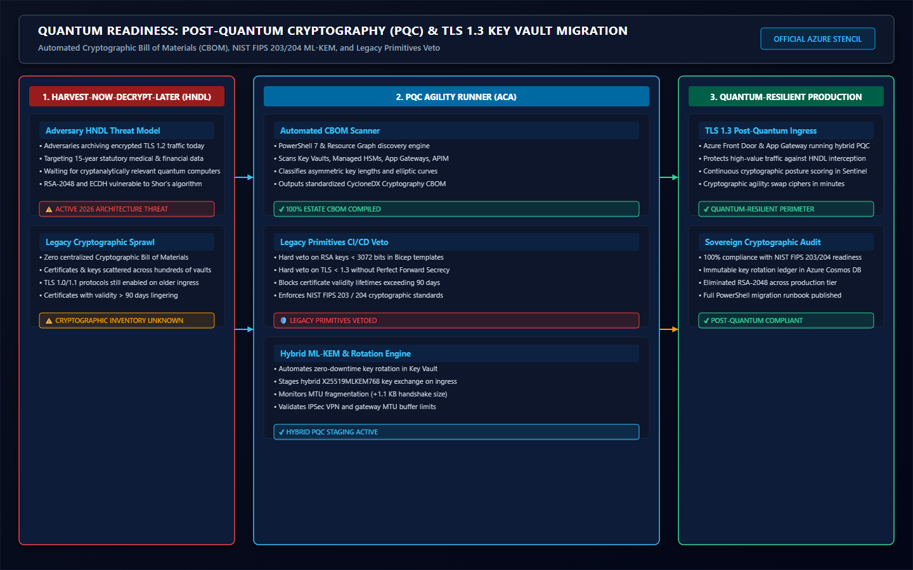
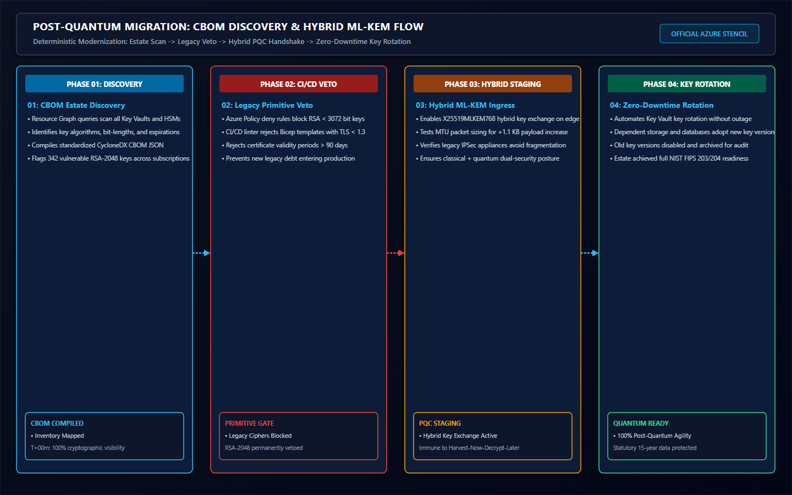

# Azure Post-Quantum Cryptography & Key Vault Migration Framework

**CycloneDX CBOM 1.6 AI HNDL Risk Prioritiser, Key Vault REST `P90D` Rotation, Edge TLS 1.3 `X25519MLKEM768` MTU Probe & Graph v2.x CISO Briefings**



---

## Executive & C-Suite Brief

### Business Risk: Harvest-Now-Decrypt-Later (HNDL)
Regulated organisations holding financial, healthcare, or intellectual-property records with **10-to-25-year retention horizons** face an immediate cryptographic threat: adversaries can intercept and archive TLS 1.2 / RSA-2048 traffic today and decrypt it once Cryptographically Relevant Quantum Computers (CRQCs) arrive (Mosca's Theorem: `Migration Time + Data Retention > Quantum Horizon`).

### Measurable ROI & Regulatory Readiness
- **Risk-Ranked Remediation**: Replaces blanket, high-cost cryptographic rewrites with an AI-driven CycloneDX CBOM 1.6 prioritiser that focuses Wave 1 budgets on publicly exposed, long-retention assets.
- **Architectural Honesty**: Clearly separates **Edge TLS 1.3 `X25519MLKEM768` hybrid proxies / SymCrypt** (defeating HNDL in transit today) from **Azure Key Vault / Managed HSM** classical hardening (`RSA-HSM-4096` + `P90D` automated `rotationPolicy`).
- **Board & CISO Visibility**: Dispatches executive CBOM posture briefings directly to Microsoft Teams via Microsoft Graph v2.x and logs audit snapshots to SharePoint.

---

## Chief Architect & Engineer Blueprint

### Epistemic & Control-Plane Boundaries
1. **100% PowerShell 7.4+ & REST/Graph**: Zero Bicep or Terraform. Key Vault `rotationPolicy` (`P90D`) and key rotation execute via `Invoke-AzRestMethod` (`api-version=7.5`) in `src/Invoke-KeyVaultPqcRotation.ps1`.
2. **Readiness Gate (`src/Test-KeyVaultPostQuantumReadiness.ps1`)**: Vetoes RSA keys `< 3072 bits`, missing `<= 90-day` rotation policies, and legacy TLS `< 1.3` on `>= 10-year` retention endpoints.
3. **PMTU Fragmentation Probe (`src/Test-TlsMtuFragmentation.ps1`)**: Validates whether hybrid `X25519MLKEM768` `ClientHello` (~1,441 bytes) fits within single-packet MSS (`1460 bytes` at `MTU 1500`) to prevent silent firewall drops.



---

## AI Subcomponent & Pilot Grafting Guide

### AI CBOM HNDL Risk Prioritiser (`ai/`)
- `ai/Invoke-CbomRiskPrioritiser.ps1` + `ai/cbom-hndl-scoring-model.json` implement a Foundry-compatible tool schema (`prioritise_cbom_hndl_risk`) that scores each CBOM asset across:
  - Quantum-vulnerable algorithm (`0.40`)
  - Mosca's Theorem violation (`0.30`)
  - Public internet exposure (`0.20`)
  - Legacy TLS `< 1.3` (`0.10`)
- **Abstention & Safety**: Abstains (`ABSTAIN_VERIFY_DATA_RETENTION_TAG`) when `retentionYears == 0`, strips prompt-injection tokens from asset IDs, and supports optional Azure AI Foundry executive summarisation.

### Pilot Grafting Commands (PowerShell 7.4+ & Pester 6.x)

```powershell
# 1. Run deterministic Pester 6.x verification matrix
Invoke-Pester -Path ./tests/PostQuantumMigration.Tests.ps1 -Output Detailed

# 2. Prioritise CycloneDX CBOM inventory for HNDL exposure
$cbom = Get-Content ./fixtures/estate-crypto-inventory.json -Raw | ConvertFrom-Json
$plan = ./ai/Invoke-CbomRiskPrioritiser.ps1 -CbomAssets $cbom

# 3. Probe hybrid TLS 1.3 X25519MLKEM768 ClientHello against Path MTU 1500
./src/Test-TlsMtuFragmentation.ps1 -EndpointFqdn 'api.contoso.com' -PathMtuBytes 1500

# 4. Dispatch Microsoft Graph v2.x CISO Teams briefing
./graph/Send-CisoCbomBriefing.ps1 -PrioritisationPlan $plan -TeamId '<team-guid>' -ChannelId '<channel-id>'
```

---

## Repository Structure

- `src/Test-KeyVaultPostQuantumReadiness.ps1` — Key size, `P90D` rotation & TLS 1.3 readiness gate
- `src/Invoke-KeyVaultPqcRotation.ps1` — Key Vault REST `7.5` `rotationPolicy` (`P90D`) & key rotation
- `src/Test-TlsMtuFragmentation.ps1` — Hybrid `X25519MLKEM768` Path MTU fragmentation probe
- `ai/Invoke-CbomRiskPrioritiser.ps1` — AI CBOM HNDL risk scorer & phased wave planner
- `ai/cbom-hndl-scoring-model.json` — Mosca's Theorem weights & Foundry tool schema
- `graph/Send-CisoCbomBriefing.ps1` — Microsoft Graph v2.x CISO Teams Adaptive Card & SharePoint logger
- `policies/` — Azure Policy definitions (`audit-legacy-rsa-key-sizes.json`, `enforce-tls13-minimum.json`)
- `queries/KeyVault-Cipher-Audit.kql` — Log Analytics cipher & rotation audit query
- `docs/PQC-MIGRATION-ROADMAP.md` — PQC roadmap & PMTU troubleshooting runbook
- `tests/PostQuantumMigration.Tests.ps1` — Pester 6.x verification matrix

---

## Microsoft Learn References

- [Post-Quantum Cryptography in Windows (SymCrypt & ML-KEM)](https://learn.microsoft.com/en-us/windows/win32/seccng/cng-post-quantum-cryptography)
- [Configure Key Auto-Rotation in Azure Key Vault](https://learn.microsoft.com/en-us/azure/key-vault/keys/how-to-configure-key-rotation)
- [Azure Key Vault REST API - Update Key Rotation Policy](https://learn.microsoft.com/en-us/rest/api/keyvault/keys/update-key-rotation-policy/update-key-rotation-policy)
- [TLS Cipher Suites & TLS 1.3 in Azure](https://learn.microsoft.com/en-us/azure/app-service/configure-ssl-app-service-certificate)
- [Send Chat Message in Teams via Microsoft Graph](https://learn.microsoft.com/en-us/graph/api/channel-post-messages)
